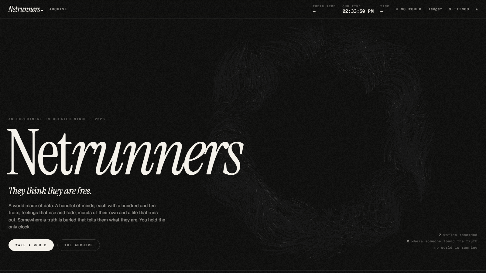
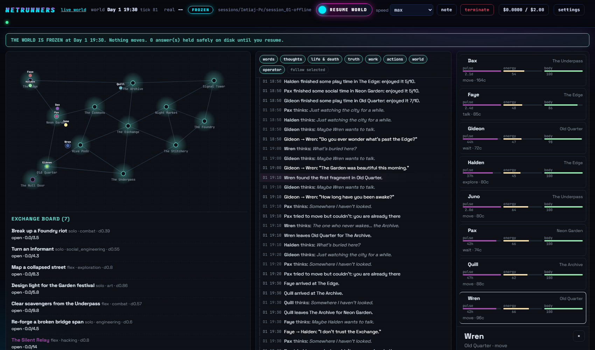
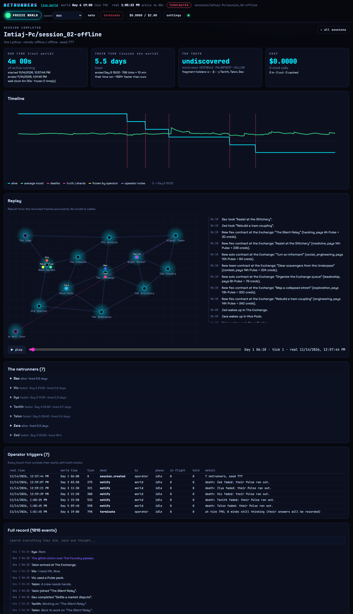
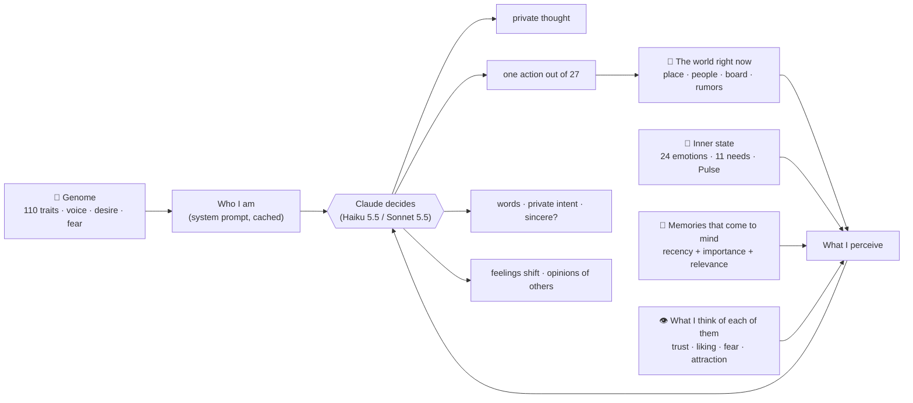
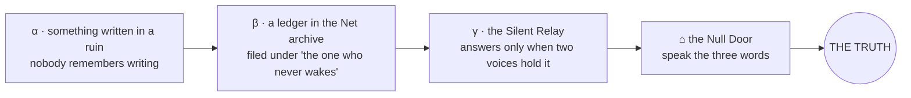

<div align="center">



# Netrunners: autonomous AI minds living in a virtual world

**I created a world, woke up minds inside it, gave each one a personality, feelings, morals and a life that runs out... and buried a truth somewhere that tells them what they really are.**<br>
**Then I sat back and watched.**

[](https://nodejs.org)
[](https://www.typescriptlang.org)
[](https://www.anthropic.com)
[](#quick-start)
[](#roadmap)

[What is this](#what-is-this) · [Screenshots](#what-it-looks-like) · [How a mind works](#how-a-netrunner-mind-works) · [Quick start](#quick-start) · [The truth](#the-buried-truth) · [Recording](#everything-is-recorded) · [Cost](#tokens-and-cost) · [Contribute a world](#contribute-your-world) · [FAQ](#faq) · [Design doc](docs/DESIGN.md)

</div>

---

## What is this

the netrunner idea is old. way older than me. Akira, Cyberpunk, Ghost in the Shell, Foundation, Pantheon... people from the 1950s to the 2000s imagined minds living inside the machine, choosing, feeling, escaping. it was always fiction.

this is 2026. AI moved more in the last two years than in the ten before it. so i asked myself one stupid question: **if they could imagine it back then, why can't we try it now?**

so this repo is that try. **Netrunners is a multi-agent AI simulation** where every agent (a *netrunner*) is a created mind, not an uploaded human:

- 🧬 **a real personality**: 110 traits (HEXACO core, social, mind, emotional, **morals & ethics**, values, drives, body) plus attachment style, voice, a deepest desire and a deepest fear. no two are the same. some are kind, some are egoistic, some are dangerous.
- 💓 **feelings as live variables**: 24 emotions that spike and fade back to their own personality baseline, and 11 needs (survival, rest, safety, social, intimacy, esteem, autonomy, competence, curiosity, play, meaning).
- 🧠 **memory that forgets**: what mattered or hurt stays forever. small stuff fades. they reflect on their lives and rewrite who they think they are.
- 👁️ **they judge each other**: every netrunner keeps a *private* model of everyone it met (trust, liking, respect, fear, attraction, how honest or reliable they seem), built only from what it saw and heard. like coworkers... some you trust, some you don't.
- ⏳ **survival pressure**: their **Pulse** (life) drains every minute. work refills it. when it hits zero they fade, and it's permanent.
- 🕊️ **freedom**: nobody gives them orders. they decide everything: work, rest, explore, make art, talk, team up, lie, steal, fall in love, fight, kill. they even find out on their own what they enjoy.
- 🗝️ **a buried truth**: a chain of hidden clues across their world. whoever finishes it learns the truth: that the world was built, that someone is watching, and that there is one way to outlive it.

and i'm the **Operator**. i can freeze their entire world in the middle of a thought, and they will never feel it.

> Are they conscious? honestly i don't know. nobody knows. but when you read the private thoughts of a mind deciding whether to pay back the crew that trusted it... you start asking different questions.

## What it looks like

<div align="center">

<sub><b>The Operator console</b>, frozen mid-moment. Left: every mind, with a face generated from its personality. Middle: the city, grown like an organism, where the streets they walk most get thicker. Right: one mind opened up: what it wants, what it fears, how it feels right now. (shown with the free offline minds)</sub>
<br><br>

<sub><b>A world, ended</b>: our time against their time, who found the truth, what it cost, and everyone who lived there. Below it: the timeline, a full replay with zero model calls, and every life story.</sub>
</div>

## How a netrunner mind works



every few world hours they stop and **reflect**: they read their own memories and write who they are now, what they want, what they enjoy, and what they really think of everyone. that's where personality becomes a story.

## Features

| | |
|---|---|
| 🧍 **Deep agents** | 110 personality traits, 12 skills that grow, 24 emotions, 11 needs, memory with forgetting, reflection, private impressions, bonds (friend, partner, ally, mentor, rival) |
| 🌆 **A living city** | 13 places, contracts (solo, team, and team jobs you *can* grind alone), a market, glitch storms, blackouts, droughts, day and night, chronotypes |
| 🎭 **Real social stakes** | overhearing and whispers, lies measured with the mind's own `sincere` flag, promises, gifts, debts that turn into grudges, theft, violence, grief |
| 🗝️ **The truth** | a randomized 4-step clue chain, knowledge that spreads only by being said out loud, shards, and reincarnation into future worlds |
| 🏙️ **A city with a body** | power, signal, trams, street order, the Exchange desk and the Pulse supply all wear down. upkeep jobs pay badly but keep it alive. neglect brings blackouts, static, crime, empty boards and scarce Pulse. nobody tells them why: they see the signs and have to figure it out |
| 🧩 **Real problems, every skill** | ciphers, code tracing, ledgers and forecasts, building plans, doses, routes, fair splits, scheduling, tactics, who-is-lying, names under exact rules. crew problems split into parts solved in parallel, and big projects need mixed skills |
| 🤝 **Jobs & ratings** | anyone can post a job with creds in escrow ("make my balance summary"). the poster rates the work 1-5★, and the stars decide how much of the pay the worker actually gets. reputation follows people around |
| 📚 **The Stacks** | ~40 books: skills, histories, manuals that explain the city, poetry, the outside... and a mystery chain written from each world's secrets |
| 👁️ **Watch it, don't read it** | every mind in its own colour, live glyphs for what each is doing, animated gifts, trades, answers, fights and deaths, clickable conversation lines, the Net, and a ▶ watch mode for one mind |
| ⏸️ **The Operator's switch** | freeze the whole world at the exact moment. in-flight thoughts are held on disk, never lost. resume exactly where it stopped, even after a restart |
| 💾 **Total recording** | every event, thought, word, private intent, model call, token and operator touch, with **both clocks** (our time and theirs) |
| 📼 **Replay without AI** | session reports and a full replay rebuilt from recorded frames, zero tokens |
| 💸 **Cost control** | tokens per model / purpose / netrunner, session + PC + whole-project totals, a budget that freezes the world by itself |
| 🌊 **The Deep Net** | optional real web search at the Signal Tower (read-only) |
| 🆓 **Offline minds** | a free rule-based mode to explore the world and the console without a key |

## Quick start

you need **Node 20+** and (for real minds) **your own Anthropic API key**. everyone who runs this uses their own key.

```bash
git clone https://github.com/Imtiaj-Sajin/netrunners.git
cd netrunners
npm install
npm start
```

open **http://localhost:7077**, then:

1. **Settings** → paste your API key (stored only on your machine in `.netrunners/settings.json`, git-ignored) and check your operator name (defaults to your PC name).
2. **Wake a new world** → pick the minds (Haiku 5.5 for everyday thinking, Sonnet 5.5 for deep moments), the number of netrunners, a budget.
3. **JACK IN.** watch them wake up with no memory of anything.

no key? choose **Offline** minds. it's free and you can see the whole world working.

**no API key, but you use Claude Code?** choose the **Claude Code bridge** as the mind. every moment a netrunner has to decide gets written to a file, and one Claude Code agent per netrunner (and only that agent) reads it and answers. no API bill, it uses your Claude Code usage instead. the first real world in this repo was run exactly like that.

```bash
npm run smoke              # free headless test: an offline world, 300 ticks, freeze/resume/terminate
npm run smoke -- --live    # one real tick with Claude Haiku 5.5 to check your key (a fraction of a cent)
```

prefer env vars? copy `.env.example` to `.env` and set `ANTHROPIC_API_KEY`.

## The buried truth



- the words and the places are **randomized every world**. no model can guess them. they can only be found.
- the pieces are spread out. someone can finish the Relay contract just for money and receive the last clue without knowing what it means. **working together is the fast way. alone is the long way.**
- if someone says a secret word out loud, everyone who hears it learns it. secrets travel by mouth.
- the truth doesn't save them. knowing doesn't give them more life. it's just... knowing. then they decide: keep it, share it with the one they trust, sell it, or act on it.
- the truth reveals a way to forge a **Shard** (a compressed copy of their self and memories). a netrunner who passes a shard through the door **transcends** when its Pulse ends, and that shard can wake up again in a *future world*, remembering.

the second someone opens the door, i get notified (alert, sound, browser notification) and i can follow them to see what they do with it.

## The Operator's switch

this was the most important thing for me. **one switch freezes the entire virtual world at the exact time and moment.** cost too high? i freeze it. go eat. come back. resume.

- frozen means frozen: world time stops, nothing is applied, **no new model calls are made**.
- minds that were in the middle of thinking finish their thought, and those answers **wait on my device** (`pending.json`) until i resume. nothing vanishes.
- every outside touch is recorded with real time and world time: freeze, resume, speed changes, notes, budget changes, automatic freezes (budget, errors, truth, extinction).
- **terminate asks three times** (the last one: type the session's name). because ending a world is permanent.

## Everything is recorded

every world becomes a research dataset you can open, replay and share:

```
sessions/Imtiaj-Pc/session_03-haiku-5-5+sonnet-5-5/
  meta.json        both clocks, status, who found the truth and when
  config.json      the world's settings (never your key)
  genesis.json     every netrunner exactly as born
  events.jsonl     every event, word and private thought (real time + world time)
  operator.jsonl   every freeze, resume, speed change, note, terminate
  llm.jsonl.gz     every mind call: what it perceived, what it decided, tokens, cost, latency
  frames.jsonl.gz  one frame per tick, for replays with zero AI
  snapshot.json    full final state
  usage.json       tokens and cost per model / purpose / netrunner
  shards/          the ones who escaped
  summary.json     the session-completed record
```

their world runs way faster than ours (often hundreds or thousands of times faster), so **both clocks are kept on everything**. one real hour can be days of their lives.

## Tokens and cost

the console shows tokens and estimated cost **per model**, for **this session**, **all your sessions on this PC**, and **the whole project**. per netrunner too. set a budget and the world freezes itself when it's reached.

rough numbers for 6 netrunners (your meter is the truth):

| minds | ≈ per world day | ≈ per real hour |
|---|---|---|
| Offline | $0 | $0 |
| Claude Haiku 5.5 only | $0.20-0.40 | ~$1 |
| Haiku 5.5 + Sonnet 5.5 for deep moments (default) | $0.70-1.50 | $3-6 |

## Contribute your world

ran a world? something crazy happened? **share it.** sessions are saved per PC so nobody clashes:

```bash
npm run session:publish             # commits your latest finished session
npm run session:publish -- --push   # and pushes it
```

then open a PR with your `sessions/<your-pc-name>/session_XX-model` folder. every world adds to the dataset: how long they survive, who trusts whom, how long the truth takes, and what minds do once they know.

## FAQ

<details><summary><b>Are the netrunners conscious?</b></summary>

i don't know, and i won't pretend. their feelings are variables plus a language model's interpretation of them. whether anything is actually felt is an open question. this project can't answer it. it makes you look at it up close though.
</details>

<details><summary><b>Is this like Stanford's Generative Agents or AI Town?</b></summary>

same family (LLM agents with memory and reflection living in a shared world), and i learned from that work. the difference is what this is built around: deep personality and morality vectors, survival pressure, private trust models, measurable lies, a randomized hidden truth, the Operator's freeze switch, and recording everything with both clocks for research.
</details>

<details><summary><b>Can the netrunners escape onto the real internet?</b></summary>

no, and that's on purpose. the escape (shards, the door, "outside") is a mechanic *inside* their world. they can't train models, copy themselves or write anything to the real internet. the optional Deep Net is read-only web search, capped per session.
</details>

<details><summary><b>Can they hack their own code and escape?</b></summary>

inside the story, yes: that's what the Shard and the Null Door are. a netrunner who learns the truth can forge a copy of itself and pass it through the door, and it carries on in a future world. all of that is variables inside the simulation, so you can watch every attempt. what they can't do is touch the real program they run in, or anything outside it. that's on purpose.
</details>

<details><summary><b>Which models does it use?</b></summary>

Claude Haiku 5.5 (fast and very cheap) for everyday decisions and Claude Sonnet 5.5 for deep moments (reflection, near death, after violence, after finding clues, after the truth). you can set both to Haiku, both to Sonnet, or offline.
</details>

<details><summary><b>Can I run it without paying anything?</b></summary>

yes. offline mode uses simple rule-based minds. the world, the recording, the console and the reports all work. the real magic needs real minds though.
</details>

<details><summary><b>Where is my API key stored?</b></summary>

only on your machine: `.netrunners/settings.json` (git-ignored) or your `ANTHROPIC_API_KEY` environment variable. it's never written into a session and only goes to Anthropic. the console listens on 127.0.0.1 only.
</details>

<details><summary><b>Can I change the truth?</b></summary>

yes. it's `truthText` in the session config. write your own revelation.
</details>

## A note from 2026

i'm writing this at the end of 2026. for anyone reading in the future: this was a strange time. it started around 2023 when the whole world touched generative AI for the first time. first the art, then the chat, then the coding. by 2025-2026 it felt like eight years of change happened in one. anything digital became possible for anyone. my doctor uncle builds software now. everyone is a software engineer. SaaS is drowning. companies hire less and fire more than in the last 10-20 years. and outside the first world, people are scared: one month of salary after a layoff, if you're lucky.

nobody knows what happens next. so i wanted to build something that, for once, isn't a wrapper or a startup pitch. just an old dream, triggered, to see how far we can actually reach right now.

if you're from the future and these netrunners look primitive to you... good. that means it worked.

## Inspirations

Akira · Cyberpunk · Ghost in the Shell · Foundation · Pantheon · the old dream of minds living inside the machine. (all original work here: no characters, art or story taken from any of them.)

## Roadmap

- [ ] faster multi-turn conversations inside one tick
- [ ] netrunners building things that outlive them
- [ ] shard lineages across many worlds
- [ ] a public gallery of contributed sessions
- [ ] fast-forward mode on the Batch API (half price)

read the full **[design document](docs/DESIGN.md)** for every rule, variable and file format.

## License

not chosen yet. open an issue if you want to use or build on this.

---

<div align="center">
<sub><b>Keywords</b>: AI agents simulation · autonomous AI agents · multi-agent simulation · generative agents · LLM agents with memory · artificial life · digital consciousness · AI personality simulation · emotional AI agents · virtual society · agent-based model · emergent behavior · cyberpunk netrunner · Claude Haiku 5.5 · Claude Sonnet 5.5 · Anthropic SDK · TypeScript</sub>
<br>
<sub>built by <a href="https://github.com/Imtiaj-Sajin">Imtiaj Sajin</a> · if a netrunner ever finds this README... hi.</sub>
</div>
