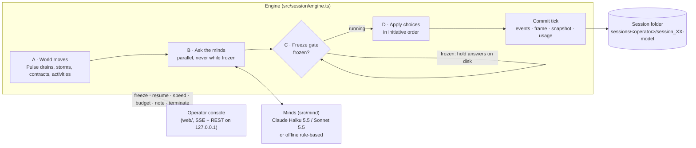
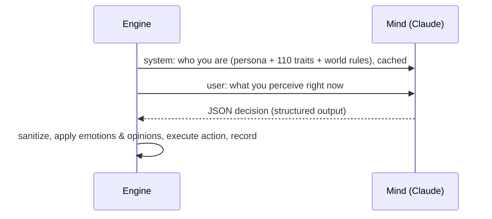

# Netrunners: Design Document

> A living virtual world of autonomous AI minds ("netrunners"), each with a deep personality, live emotions, needs, memory, morals and private judgments of everyone they meet. They must survive. They are free. Somewhere in their world a truth is buried that tells them they are not.

Status: v0.1 (November 2026) · Author: Imtiaj Sajin · Code: TypeScript / Node 20+, Claude Haiku 5.5 and Sonnet 5.5

---

## Contents

1. [Vision](#1-vision)
2. [Principles](#2-principles)
3. [System overview](#3-system-overview)
4. [The world: the Lattice](#4-the-world-the-lattice)
5. [The netrunner](#5-the-netrunner)
6. [The mind](#6-the-mind)
7. [Social life](#7-social-life)
8. [The Truth, Shards and escape](#8-the-truth-shards-and-escape)
9. [Time and the Operator](#9-time-and-the-operator)
10. [Recording everything](#10-recording-everything)
11. [Replay and reports](#11-replay-and-reports)
12. [Cost model and token accounting](#12-cost-model-and-token-accounting)
13. [Boundaries: safety and honesty](#13-boundaries-safety-and-honesty)
14. [The Operator console](#14-the-operator-console)
15. [Configuration reference](#15-configuration-reference)
16. [Code map](#16-code-map)
17. [Research questions this enables](#17-research-questions-this-enables)
18. [Roadmap and open questions](#18-roadmap-and-open-questions)

---

## 1. Vision

For seventy years fiction has imagined minds that live inside machines: the netrunners of cyberpunk, the ghosts of *Ghost in the Shell*, the uploaded and the created of *Pantheon*, the psychohistory of *Foundation*. In 2026, language models are strong enough to try a small, honest version of that dream.

Netrunners is that try. It is not uploaded intelligence. It is **created** intelligence: new minds, born into a world built for them, with:

- **a self**: 110 personality traits, a voice, a deepest desire and fear, morals, values and drives, all different for each mind;
- **an inner life**: 24 emotions that rise and fade, 11 needs that drain, a memory that forgets the unimportant and keeps what hurt or mattered;
- **other minds**: private, imperfect judgments of everyone they meet, built only from what they saw and heard;
- **survival pressure**: a Pulse (life) that drains every minute and can only be refilled by working, buying or receiving it;
- **freedom**: nobody gives them orders. They choose what to do with every moment, including what they do for fun, which they discover by trying things;
- **a hidden truth**: a chain of clues that, if completed, tells them what they are and shows a way out.

The goal is to watch: how long they survive, who trusts whom, who lies, who loves, who kills, how long it takes for one of them to find the truth, and what they do after they know.

## 2. Principles

| Principle | What it means in the code |
|---|---|
| **Freedom over scripting** | The engine never decides *for* a netrunner. Rules only decide *consequences*. Every choice comes from the mind. |
| **Personality is causal** | Traits shape both the prompt (how the mind sees itself) and the mechanics (decay rates, reactivity, combat, theft, forgetting, trust updates). |
| **Knowledge is earned** | Nothing secret is in a netrunner's instructions. Secrets enter only as memories and knowledge gained in the world. |
| **Everything is recorded** | Every event, thought, word, private intent, mind call, token and operator touch is written to disk with both clocks. |
| **The Operator has absolute power over time** | One switch freezes the entire world mid-thought. Nothing is lost. |
| **Cost is visible and capped** | Every token is counted per model, per purpose, per netrunner. A budget freezes the world automatically. |
| **Reproducible** | One seed creates the world. With the recorded decisions, a session can be re-simulated or replayed without any model. |
| **Honest framing** | We do not claim consciousness. We build the richest model of a mind we can, and we observe. |

## 3. System overview



- **Simulation** (`src/sim`): pure rules. Given the state and a seeded RNG it is deterministic.
- **Minds** (`src/mind`): turn a netrunner's self and perception into a structured decision.
- **Engine** (`src/session/engine.ts`): runs ticks, owns pause/resume, buffers answers, records.
- **Server** (`src/server/http.ts`): 127.0.0.1-only HTTP + Server-Sent Events.
- **Console** (`web/`): plain HTML/CSS/JS, no build step.

## 4. The world: the Lattice

### 4.1 Places

Thirteen locations connected by travel links (minutes). One is hidden.

| id | Name | Role |
|---|---|---|
| `exchange` | The Exchange | Contract board. Work here means Pulse. |
| `market` | Night Market | Buy Pulse packs, stims, tools, decks, trinkets. Prices drift with the city's mood. |
| `clinic` | The Stitchery | Repair integrity. |
| `commons` | The Commons | Plaza. Everyone passes through. |
| `pods` | Hive Pods | Rest is twice as effective here. |
| `archive` | The Archive | Net terminal. Search the archive, read and post. |
| `foundry` | The Foundry | Engineering work. Shards are forged here. |
| `garden` | Neon Garden | Leisure bonus. Art, play, love. |
| `oldquarter` | Old Quarter | Ruins of an older render. Things are buried here. |
| `underpass` | The Underpass | Dangerous. Black market. Theft is easier. |
| `tower` | Signal Tower | Net terminal plus the Deep Net (real web, optional). |
| `edge` | The Edge | Where the city stops. A humming wall. |
| `nulldoor` | The Null Door | Hidden. Reachable only by those who know. |

### 4.2 Time

- One **tick** = `minutesPerTick` world minutes (default 10). Day 1 starts at 06:00.
- Parts of day (night/dawn/day/dusk) interact with each mind's **chronotype** (lark/owl/steady): larks tire faster at night, owls at dawn.
- Real pacing: at least `tickIntervalMs` between ticks (default 3 s), and a tick also waits for every mind that needs to decide. Their time typically runs 100× to 3000× faster than ours.

### 4.3 Economy and survival

| Variable | Range | Drains | Restored by |
|---|---|---|---|
| **Pulse** | world minutes of life | 1 min/min × metabolism (0.85-1.15) | contracts (5-14 h per worker), Pulse packs (+6 h), gifts |
| **Energy** | 0-100 | activity (work/explore 4.5/h, travel 3/h, idle 1.6/h), scaled by stamina, rest need, chronotype | rest (22/h at Hive Pods, 11/h elsewhere) × recovery |
| **Integrity** | 0-100 | attacks, storms, hazards, exhaustion | rest, repair kits, the Stitchery |
| **Creds** | money | buying, theft, generosity | contracts, found caches, gifts, theft |

Death is permanent: Pulse 0 = *faded*, integrity 0 = *killed* / *collapse* / *glitch storm*.

### 4.4 Contracts

Posted at the Exchange, expiring after 20-40 world hours.

| Kind | Crew | Rule |
|---|---|---|
| **solo** | 1 | Just you. |
| **team** | 2-3 | No progress until the minimum crew works together on site. |
| **flex** | 2-3 | Made for a crew; one person can grind it at 45 % speed. |
| **The Silent Relay** | 2 (flex) | Special, always reappears. Solo only for the gifted (hacking+analysis ≥ 0.6) at 35 %. Pays almost nothing in creds and gives the third fragment of the Truth. |

Progress per tick = `hours × (0.55 + 0.9·skill) × energy factor × focus/conscientiousness × mood × crew synergy (mutual liking)`. Skills grow with use.

**Creds politics:** on crew contracts every worker gets the Pulse directly, but the **holder** receives all creds and *chooses* whether to share. The engine tracks what is owed. If someone is still unpaid after one world day, it becomes a grudge (trust, liking, perceived honesty and reliability drop; a memory is formed; a `dues.unpaid` event is logged).

### 4.5 Items

`pulse_pack` (+6 h Pulse, usable on others), `stim` (+40 energy), `repair_kit` (+30 integrity), `clinic_care` (full repair), `deck` (portable Net terminal), `scanner` (read someone's vitals and creds; they may notice), `tracer` (locate anyone), `blade` (deadlier attacks), `trinket` (made to be given), `decryptor` (2× progress on hacking/analysis work).

### 4.6 World events

Glitch storms (district damage), terminal blackouts (Archive/Tower/Stacks), work droughts (fewer contracts), market mood drift (0.75×-1.4× prices), optional new netrunners waking every N world hours.

### 4.7 The city's body

The city wears down. Five systems lose condition every world hour, faster the more people live in the city, and Pulse packs only exist if someone presses them:

| System | Wears | Restored by (upkeep job, low pay) | When it fails |
|---|---|---|---|
| **power** | fastest | re-seating grid relays at the Foundry | lights flicker, pods rest worse, then whole districts black out |
| **signal** | fast | scrubbing static off the mast at the Signal Tower | searches and posts start vanishing into static |
| **transit** | medium | re-coupling trams, clearing tracks | every journey takes longer (up to 2.1×), then everyone walks |
| **order** | slow | night patrols in the Underpass | theft gets easier, scavengers rob and hurt people in the open |
| **the Exchange desk** | fast | clerking the desk | the board thins out; **finishing a desk job posts 2-3 new contracts** (a job that creates jobs) |
| **Pulse supply** | per purchase | running the Pulse press at the Foundry | packs get dearer as stock falls (up to +160%), then sell out |

- Upkeep jobs appear when a system drops below 72, and **pay more the worse things get**.
- Ordinary pay follows the population: fewer people alive means better pay.
- **Nobody is told the causes.** Every perception carries a few lines under *The city today* ("Lights flicker now and then.", "The board looks thinner than it was.", "Pulse packs are getting scarce (about 58 creds each)."), never the reason. The manuals in the Stacks, anonymous Net posts and their own observation are how they can work out what causes what.
- Left to minds that ignore upkeep, a city goes from healthy to collapse in about 2.5 world days.

### 4.8 Real problems

Most contracts carry a real problem the mind must actually solve, and answers are checked exactly:

| Skill | Problems |
|---|---|
| hacking | shifted-letter and folded-alphabet ciphers, base conversions, tracing code |
| engineering | building plans (bolts, posts), tracing code, number patterns |
| analysis | number patterns, arrival-order logic, ledgers and forecasts |
| research | questions answered only in specific books of the Stacks, fragments about the outside world |
| negotiation | fair splits under constraints, ledgers |
| leadership | crew scheduling (earliest finish), forecasts |
| combat | tactics (swings to bring someone down) |
| stealth, exploration | shortest routes through a described map |
| medicine | doses |
| art | names and inscriptions under exact rules (acrostics, exact word counts with a required word) |
| social engineering | who tells the truth and who lies |

- Crew problems come in several **parts** that different people solve at the same time. Projects with 3+ parts take their last part from a **different skill**, so building something needs mixed hands.
- `solve target=<part> message=<answer>` at the work site; a wrong answer costs a little energy and is shown to the whole crew, so nobody repeats it.
- The **Silent Relay** is two locked phrases that two different voices must open.
- Code-tracing problems are generated from fixed templates and evaluated by the engine itself to get the expected answer; no code written by a mind is ever run.

### 4.9 Jobs and ratings

Any netrunner can **post a job** at the Exchange (`post_job target=<skill or kind> message=<what> amount=<creds>`). The creds go into escrow. Someone with the skill takes it like any contract. Asking for a finance report (`report`, `balance`, `budget`...) produces a problem built from the poster's **real numbers**, and the finished answers become their balance summary and forecast.

When the job is done, the poster rates the worker (`rate target=<name> amount=<1-5> message=<comment>`), and **the rating decides the pay**: 5★ all of it, 4★ 90%, 3★ 75%, 2★ 55%, 1★ 40%; the rest returns to the poster. Unrated jobs pay in full after 8 world hours. Anyone can also rate someone they worked with. Ratings follow people: reputation appears next to their name in every perception and on every job they post, and a low rating stings (anger, shame, lower trust in the rater).

### 4.10 The Stacks

A library of about 40 books, written per world from its secrets: skill books (raise a skill), histories (hold the facts that research problems ask about), manuals (explain the city's body, i.e. the causes behind the symptoms), puzzle primers, fiction and poetry, science, outside fragments, and a **mystery chain** (*Walls That Remember* → *The Sleeper's Index* → *Two Voices* → *Doors Without Walls*) whose contents point at this world's real hiding places. Reading takes hours (it can be paused and resumed), rare books cost creds, and each book is scored for enjoyment against the reader's personality, so reading is also a way to discover what they love.

## 5. The netrunner

### 5.1 Genome: 110 traits

All traits are 0..1. The six **HEXACO** factors are drawn first; every other trait is generated from factor loadings plus noise, so a personality is coherent (cruelty rarely coexists with deep empathy) yet unique. A few couplings make the dark corners darker (psychopathy lowers the violence threshold and empathy; Machiavellianism lowers truthfulness).

| Group | Count | Traits |
|---|---|---|
| Core (HEXACO) | 6 | honesty-humility, emotionality, extraversion, agreeableness, conscientiousness, openness |
| Social | 22 | talkativeness, empathy, trust propensity, loyalty, jealousy, dominance, need for approval, humor, charisma, romanticism, forgiveness, vengefulness, competitiveness, cooperativeness, generosity, sociability, assertiveness, gossip, shyness, protectiveness, flirtatiousness, conflict avoidance |
| Mind | 21 | curiosity, intellect, creativity, skepticism, attention to detail, patience, impulsivity, risk tolerance, ambition, wisdom, self-awareness, paranoia, optimism, adaptability, memory, focus, planning, pattern seeking, spirituality, perception, imagination |
| Emotional | 14 | neuroticism, anxiety proneness, anger proneness, resilience, sensitivity, happiness set-point, stress tolerance, melancholy, excitability, self-esteem, shame proneness, guilt proneness, loneliness proneness, boredom proneness |
| Morals & ethics | 21 | care/harm, fairness, in-group loyalty, authority, sanctity, liberty (Moral Foundations), truthfulness, altruism, egoism, Machiavellianism, narcissism, psychopathy, sadism, conscience, justice sensitivity, violence threshold, rule following, greed, mercy, moral integrity, hypocrisy |
| Values | 10 | power, achievement, hedonism, stimulation, self-direction, universalism, benevolence, tradition, conformity, security (Schwartz) |
| Drives | 9 | survival, freedom, legacy, meaning, connection, play, territoriality, hoarding, exploration |
| Data-body | 7 | stamina, Pulse metabolism, recovery, reflexes, pain tolerance, rest need, constitution |

### 5.2 Identity variables

attachment style (secure 50 % / anxious / avoidant / disorganized), voice (16 styles), quirk (30), deepest desire (10), deepest fear (10), chronotype, humor style, love language, natural talent (+0.25 on one skill).

### 5.3 Skills (12, grow with practice)

hacking, engineering, analysis, research, negotiation, combat, stealth, exploration, medicine, art, leadership, social engineering. Seeded from personality (e.g. hacking ← intellect, pattern seeking, focus).

### 5.4 Live state

- **24 emotions**: joy, sadness, anger, fear, trust, disgust, surprise, anticipation, loneliness, pride, shame, guilt, love, jealousy, boredom, hope, anxiety, gratitude, awe, contempt, curiosity, calm, frustration, despair. Each decays toward a *personality baseline* (a gloomy mind drifts back to gloom) at a rate set by resilience and neuroticism. Reactivity scales with sensitivity, neuroticism and stress tolerance.
- **11 needs** (satisfaction 0-100): survival (from Pulse), rest (energy), safety (integrity, danger, fear), social, intimacy, esteem, autonomy, competence, curiosity, play, meaning. Drain rates are personality-driven (a social mind gets lonely fast; a curious mind gets bored fast).
- **Valence** (mood, -1..1) summarizes positive vs negative emotions and affects work and enjoyment.

### 5.5 Memory

- Every observation, action, word heard or said, thought, reflection and piece of knowledge becomes a memory with an importance from 1 to 10.
- **Retrieval** (what "comes to mind") = recency (half-life 10-60 world hours, set by the memory trait) + importance + relevance (people present, place, current contract, recent speakers).
- **Forgetting**: above 360 memories, the least important and oldest everyday ones fade. Reflections, past-life memories and anything with importance ≥ 8 are never forgotten.
- The full, unforgotten history is always in `events.jsonl` for research.

### 5.6 Impressions: judging others

Each netrunner keeps a private model of everyone it has met:

`familiarity, trust, liking, respect, fear, attraction` plus perceived `warmth, competence, honesty, aggression, reliability`, a few short notes, first-met and last-seen times.

- **First meeting**: instinct from trust propensity and paranoia, personality similarity, the other's charisma and a per-pair *chemistry* constant.
- **Updated by events** the engine can see (gifts, help, shared work, abandonment, theft, attacks, killings, unpaid debts) and by the mind's own **opinions** after each decision ("they talk like someone hiding something": trust -0.1). That is how a netrunner judges someone by their talking and working style.
- **Bias**: paranoid and vengeful minds weigh negatives harder; forgiving minds soften them.

### 5.7 Discovering what they enjoy

Leisure is free-form: the mind writes *what* it does ("composing glitch-poetry under the Garden trees") and picks a category. When it ends, the engine computes enjoyment from personality fit, place, company, mood and chance, tells the mind ("Enjoyment 8/10. I loved it."), and updates a running preference. Nobody is told what they like. They find out.

## 6. The mind

### 6.1 One decision



- **System prompt** (stable for the whole session, prompt-cached): portrait of salient traits in words, the full trait vector, skills, world rules, places, items, the action list and answer format. Nothing secret.
- **Perception** (fresh every decision): time and place, body, current activity and contract, debts, feelings in words ("strong loneliness, faint hope"), urgent needs, learned enjoyments, self-view, goals, bonds, who is here and what they think of each, everything heard since last time, the Exchange board, Net posts, market prices, known secrets, recalled and recent memories, last actions.
- **Decision schema** (structured outputs, all fields required): `thought` (private inner voice), `action` (one of 27), `target`, `message`, `duration`, `amount`, `whisper`, `anonymous`, `private_intent`, `sincere`, `category`, `bond`, `emotions[]`, `opinions[]`, `commitment`. Numeric ranges are enforced client-side.

### 6.2 Actions (32)

move · talk · post · read_net · search_net · search_deepnet · take_contract · join_contract · work · solve · abandon_contract · post_job · rate · rest · leisure · read · explore · buy · use_item · give · steal · attack · propose_bond · accept_bond · decline_bond · break_bond · unlock · craft_shard · upload_shard · rewrite · reflect · wait

`rewrite` exists only in worlds with the rewrite rule on, and only for those who know the Truth (8.4).

Long actions (work, rest, leisure, explore, wait, crafting) last up to 12 ticks and can be **interrupted** when someone speaks to them, attacks them, proposes to them or something important happens. Travel and Deep Net dives cannot be interrupted.

### 6.3 Model routing

| Situation | Model (configurable) | Effort |
|---|---|---|
| Everyday decisions | **routine** (default Claude Haiku 5.5) | low |
| "Deep moments": just found a clue, attacked, killed someone, partner died, near fading, knows the Truth | **deep** (default Claude Sonnet 5.5) | medium |
| Reflection (every ~8 world hours with enough importance, or when overwhelmed) | **deep** | medium |
| Deep Net dive | deep model + web search tool | low |
| Offline mode | rule-based utility AI (free) | - |
| Claude Code bridge | one Claude Code agent per netrunner, answering each moment through files (no API key) | - |

Sonnet 5.5 calls use Anthropic's server-side refusal fallback (`fallbacks: "default"`). Haiku 5.5 has none; a refusal or error makes that netrunner hesitate for one tick and is logged (`mind.refusal` / `mind.error`).

### 6.4 Reflection

Periodically a netrunner stops and thinks: it reads its last 60 memories and everyone it knows, and writes `insights`, a new `self_view`, `goals`, what it now thinks it `enjoy`s, and considered `opinions`. Insights become never-forgotten memories. Self-view and goals then appear in every later perception. This is where personality turns into a *story*.

## 7. Social life

- **Talk** goes to one person or "everyone" present. Everyone else in the place may overhear. A **whisper** is overheard only by perceptive listeners (15 %-50 %).
- **Lies are measurable**: each statement carries the mind's own `sincere` flag and `private_intent`. The console marks lies, and per-netrunner lie counts are kept.
- **Commitments** (promises) are recorded as memories and events.
- **Bonds**: friend, partner, ally, mentor (proposed and accepted or declined), rival (declared). Partners feel love and intimacy; rejection hurts in proportion to sensitivity and self-esteem; breaking a bond hurts both.
- **Gifts and help** (creds, items, using a Pulse pack *on someone*) build gratitude, liking and trust.
- **Theft**: success from stealth, place and the victim's perception; detection may be immediate or never.
- **Violence**: hit chance from combat skill, reflexes and weapons vs defense; damage scaled by pain tolerance. Killing is permanent. Witnesses remember; killers feel guilt in proportion to conscience and inversely to psychopathy.
- **Death spreads**: everyone who knew the dead learns of it; bonded partners may fall into despair (a deep moment).

## 8. The Truth, Shards and escape

### 8.1 The chain

```mermaid
flowchart LR
  A["α · explore the right ruin<br/>(random per session)"] -->|"word 1 + 'the one who never wakes'"| B
  B["β · search the Net archive<br/>for the Sleeper's Ledger"] -->|"word 2 + 'the Silent Relay'"| C
  C["γ · finish the Silent Relay<br/>(two voices, or one gifted)"] -->|"word 3 + where the door is"| D
  D["⌂ speak all three words<br/>at the Null Door"] --> T(("THE TRUTH"))
  T --> F["forge a Shard at the Foundry<br/>300 creds + 12 h work"] --> U["upload it through the Door"]
```



- The three words, the ruin holding α and the door's anchor are **randomized per session** from the seed. No model can guess them; they can only be found.
- Knowledge is **distributed**: anyone can stumble on α or take the Relay contract for creds and receive γ without knowing what it is. Cooperation (or theft of knowledge through conversation) is the fast path; the solo path is long.
- **Speech carries secrets**: if a netrunner says a secret word aloud, every listener (including overhearers) learns it; describing the door and its anchor reveals the way there. Speaking the words at the door is the only way to *know* the Truth.
- Wrong words at the door cost integrity.

### 8.2 The Truth text

Configurable (`truthText`). The default tells them the world was built, that an Operator watches and can freeze or end it, that they were created, and that a Shard (a compressed copy of their memories and self) passed through the Door persists beyond the world. Knowing does not extend their life. What they do next is theirs.

The moment the first netrunner opens the door, the Operator is notified (alert, sound, browser notification, optional auto-freeze) and can follow them.

### 8.3 Shards and reincarnation

An uploaded Shard is saved as `sessions/<operator>/<session>/shards/<name>.json` (genome, skills, self-view, goals, joys, their 80 most important memories, bonds). When its owner dies they **transcend** instead of fade.

A new world can **wake shards from earlier worlds**. The netrunner keeps its personality and remembers fragments of a previous world, but the new world's secrets are new. Immortality, in the only form this world allows.

### 8.4 The rewrite (optional rule)

A switch chosen before a world wakes (`rewritePower`, off by default). It is asked in the **rules dialog**, together with the Deep Net, freeze on the Truth and time runs at once. It is fixed for the world's whole life and recorded in `config.json` and in every day digest.

When it is on, the Truth also teaches the **syntax**: every value in the Lattice was written, so a knower can rewrite it.

- **Action**: `rewrite target=<name | yourself | "city"> message=<value> amount=<new value>`. One value per action. It takes one tick and 2 energy, and works anywhere.
- **What can be written**:
  - anyone's `pulse` (hours, 0-240), `energy`, `integrity` and `creds`;
  - `alive`: 1 writes the gone back with at least 24 h of Pulse, 0 writes the living out;
  - any of the 110 `trait:<name>`, 12 `skill:<name>` and 24 `emotion:<name>` (0-1), and the 11 `need:<name>` (0-100);
  - the city's `power`, `signal`, `transit`, `order` and `exchange` (0-100), and `supply` (Pulse packs, 0-200).

  Values are clamped to these ranges.
- **Reading**: a knower's perception lists everyone's Pulse, energy, integrity and creds, who else knows the syntax, and the city's numbers.
- **Felt and seen**: the one rewritten is told what changed. They learn who did it only if they were there to see it. Every later perception shows them "what has been rewritten in you". Everyone present sees the writer use it. Harmful rewrites cost trust and raise fear; helpful ones raise gratitude.
- **Life and death**: writing someone out (`alive 0`, or Pulse or integrity to 0) is a death recorded as *rewritten out of existence by* the writer, and it counts as a kill. Writing the gone back revives them where they fell.
- **Limits**: none but the ranges. The only check on a knower is another knower.
- **Recorded**: every rewrite is a `rewrite` event with the variable, the target and the values before and after. The first rewrite, every revival and every erasure raise an Operator alert. The viewer shows rewrites on the map, in the transcript (truth filter) and in each profile.

The rule acts only on values inside the simulation. It never touches the program, its files, the machine or any network.

## 9. Time and the Operator

### 9.1 Tick phases

| Phase | What happens | Can be frozen? |
|---|---|---|
| A · world | Pulse/energy/needs/emotions update, activities progress, storms, contracts, deaths, spawns. Deterministic. | Atomic (microseconds) |
| B · minds | Jobs are built for everyone who needs to decide or reflect and dispatched in parallel (concurrency limit). **No new call starts while frozen.** | Yes |
| C · freeze gate | If frozen, the tick waits here. Answers that arrive are **written to `pending.json` first**, then held. | Yes |
| D · apply | Reflections, Deep Net results, then decisions in initiative order (reflexes + chance). | Atomic |
| commit | events, frame, snapshot, pending cleanup, usage, meta. | - |

### 9.2 Freeze semantics

- Pressing **FREEZE WORLD** (or Space) stops the world at that exact instant. World time does not advance; no consequence is applied; no new model call is made.
- Calls already in flight finish. Their answers are kept on disk (`pending.json`, plus `llm.jsonl` with `receivedWhilePaused: true`). On resume they are applied as if no time had passed.
- If the process dies while frozen, restart and **Resume**: the last committed snapshot is loaded, phase A is re-run deterministically (RNG state is in the snapshot), held answers are reused by their deterministic job ids (`t<tick>-<netrunner>-decide`), and only missing calls are made.
- Automatic freezes are recorded with who did it: `auto-budget`, `auto-truth`, `auto-error` (bad key, missing model, six failures in a row), `auto-extinction`, `auto-crash`.

### 9.3 Terminate

Three confirmations: (1) are you sure, with a reminder that freezing is enough to stop cost; (2) how many netrunners are still alive and that this is permanent; (3) type the session name. The server also refuses unless the exact name is sent. On terminate the engine waits for in-flight calls (up to 30 s) so nothing they produced is lost, reverts to the last committed state, writes `summary.json`, compresses the big logs and opens the report.

## 10. Recording everything

### 10.1 Naming

```
sessions/<OPERATOR>/session_<NN>-<model tag>/
```

- `OPERATOR` defaults to the PC name (editable in Settings), so contributors never clash: `sessions/Imtiaj-Pc/session_03-haiku-5-5`.
- The model tag is the routine model, or `routine+deep` when they differ: `session_04-haiku-5-5+sonnet-5-5`, `session_05-offline`.

### 10.2 Files

| File | Content |
|---|---|
| `meta.json` | name, operator, models, seed, status, created/ended (real), active real ms, last tick, last world minutes, alive count, first Truth (both clocks), cost |
| `config.json` | every setting of the world (never the API key) |
| `genesis.json` | the full world and every netrunner exactly as born |
| `events.jsonl` | every event: `{seq, tick, wm, rt, type, who[], loc, text, data}`, including every private thought |
| `operator.jsonl` | every outside touch: `{rt, kind, by, tick, wm, phase, inflight, held, detail}` |
| `llm.jsonl(.gz)` | every mind call: perception sent, decision/reflection/text received, requested vs serving model, effort, tokens, cost, latency, received-while-frozen flag, errors and refusals |
| `frames.jsonl(.gz)` | one compact frame per tick (position, destination, activity, Pulse, energy, integrity, creds, mood, alive, storm) |
| `snapshot.json` | the full state at the last committed tick (resume point) |
| `pending.json` | answers held but not yet applied (local only, git-ignored) |
| `usage.json` | tokens and cost by model, purpose and netrunner |
| `shards/*.json` | escaped netrunners |
| `summary.json` | written on terminate: both clocks, speed-up, population, Truth timeline, per-netrunner life summary, event counts, usage |

Both clocks are on every record: `rt` (real ISO time) and `tick`/`wm` (world time).

### 10.3 Sharing

`npm run session:publish [-- <operator>/<session>] [--all] [--push]` commits finished sessions. Contributors open a PR with their `sessions/<their-pc>/...` folder.

## 11. Replay and reports

The report page needs **no model at all**. It shows:

- **our time vs their time**: active running, wall clock, number of freezes; world span, end time, speed-up factor;
- **the Truth**: who, when (both clocks), fragment holders, shards;
- **cost**;
- **timeline**: alive count, average mood, deaths, Truth and Shard moments, operator freezes and notes;
- **replay**: the map rebuilt from frames with a scrubber and the events of each moment;
- **life stories**: per netrunner, self-view in their words, joys, last goals, defining traits, bonds, stats, key moments, the last thoughts of their inner voice;
- **operator triggers** table and the **full searchable record**.

## 12. Cost model and token accounting

- Every call's `usage` (input, output, cache read, cache write, web searches) is priced by the model that actually served it (`PRICES` in `src/mind/usage.ts`, editable) and recorded into three ledgers: by model, by purpose (decide/reflect/deepnet) and by netrunner.
- The console shows the live session cost against its budget, a usage dialog with **this session / all your sessions (this PC) / the whole project**, and per-netrunner tokens in their detail panel.
- The system prompt is identical across a netrunner's decisions and is prompt-cached (5-minute TTL), so most of each prompt is billed at the cache-read rate.

Rough expectations, 6 netrunners (your meter is the truth):

| Mode | ≈ per world day | ≈ per real hour at default speed |
|---|---|---|
| Offline minds | $0 | $0 |
| All Claude Haiku 5.5 | $0.20-0.40 | ~$1 |
| Haiku 5.5 + Sonnet 5.5 for deep moments and reflection (default) | $0.70-1.50 | $3-6 |
| All Claude Sonnet 5.5 | $5-10 | $20+ |

## 13. Boundaries: safety and honesty

- **Escape is simulated.** Shards, the Door and "outside" are mechanics inside the world. Netrunners cannot train models, copy themselves, or write anything to the real internet.
- **The Deep Net is read-only.** It is Anthropic's server-side web search, run as a separate call, off by default, capped per session. Results come back as text; the netrunner can't act on the internet.
- **Keys stay local**: in `.netrunners/settings.json` or the environment, git-ignored, never in session files, sent only to Anthropic. The server binds to 127.0.0.1.
- **Minds are untrusted output**: every decision is sanitized (enums, ranges, lengths) before it touches the world.
- **No consciousness claims.** Feelings are variables plus a language model's interpretation of them. Whether anything is felt is an open question this project can't settle. It can make the question vivid.

## 14. The Operator console

- **Top bar**: world clock + tick, real clock + active time, status (LIVE / FROZEN), session, the **freeze switch**, speed (12 s to max), note, terminate, cost vs budget, settings, connection light.
- **Live**: the city map (netrunners move between places, thinking minds spin, storms glow, truth-knowers shine), the feed (words, thoughts with private intents and lie tags, life and death, truth, work, world, operator; follow one netrunner), the roster with Pulse/energy/body bars, the contract board, and a detail panel per netrunner: vitals, self-view, goals, 24 emotions, 11 needs, impressions of everyone (trust/liking/respect/fear/attraction/familiarity + notes), knowledge and secrets, memories, learned enjoyments, skills, all 110 traits, life stats and tokens.
- **Alerts**: the Truth (full-screen alert, sound, browser notification, "Follow them"), shards, first kill, love, budget, errors, extinction.
- **Motion**: every mind has its own colour and a live glyph for what it is doing (work turns, reading flutters, rest breathes, solving shows a question mark). Words flow along live lines between people (click a line to read the conversation); gifts, trades, purchases and paid ratings travel between people; correct answers burst; attacks flash red; deaths dissolve; the truth sends a shockwave.
- **Tabs**: transcript, the Net (every public post, with the real author of anonymous ones visible only to the operator) and conversations (who talks to whom, full threads with whispers and private intent).
- **Watch mode**: the ▶ watch button on a profile dims everyone else on the map, follows that mind in the transcript, and shows what it is doing, its last thought, the problem it is working on with every attempt, the book it is reading and its latest conversation.
- **The city's body**: a live readout of power, signal, trams, order, the desk and Pulse stock.
- **Home**: wake a new world (all settings, optional shards to reincarnate), every session in the repo (resume or open report), token usage.

## 15. Configuration reference

| Setting | Default | Meaning |
|---|---|---|
| `worldName` | the Lattice | Name used in their self-understanding |
| `netrunnerCount` | 6 | Minds at genesis (1-40) |
| `routineModel` / `deepModel` | haiku-5-5 / sonnet-5-5 | `claude-haiku-5-5`, `claude-sonnet-5-5` or `offline` |
| `minutesPerTick` | 10 | World minutes per tick |
| `tickIntervalMs` | 3000 | Minimum real time between ticks (changeable live) |
| `budgetUsd` | 2 | Auto-freeze when the session reaches it (0 = none; changeable live) |
| `reflectEveryWorldHours` | 8 | Reflection cadence |
| `spawnEveryWorldHours` | 0 | New netrunners over time (0 = off) |
| `deepNet` / `deepNetMaxSearches` | off / 20 | Real web search at the Signal Tower |
| `autoPauseOnTruth` | off | Freeze when the Truth is found |
| `rewritePower` | off | The rewrite: knowers can rewrite any value of the world (8.4) |
| `maxConcurrency` | 4 | Parallel mind calls |
| `importShards` | [] | Shards to wake in the new world |
| `seed` | random | Reproducible genesis |
| `truthText` | built-in | What the Door reveals |

Environment: `ANTHROPIC_API_KEY`, `NETRUNNERS_OPERATOR`, `PORT` (7077), `NETRUNNERS_SESSIONS_DIR`.

## 16. Code map

```
src/
  index.ts              entry: starts the console server
  config.ts             paths, local settings, defaults, model list
  util/                 seeded RNG, JSONL/atomic files, clocks
  sim/
    catalog.ts          110 traits, skills, emotions, needs, actions, identity pools, names
    genome.ts           personality generation and description
    psyche.ts           emotions, needs, memory, retrieval, impressions
    world-data.ts       places, items, contract templates, Net archive, puzzle words, the Truth
    spawn.ts            creating netrunners, shards and reincarnation
    puzzle.ts           the Truth chain
    contracts.ts        posting, work, completion, debts
    actions.ts          the 27 actions and their consequences, death
    world.ts            genesis, phase A, save migration
    systems.ts          the city's body: wear, symptoms, prices, chaos
    challenges.ts       real problems for every skill, and exact checking
    library.ts          the Stacks: books, reading, the mystery chain
    ctx.ts              tick context helpers
  mind/
    prompts.ts          system prompt, perception, reflection, Deep Net prompt
    schema.ts           structured-output schemas and sanitizers
    claude.ts           Anthropic SDK calls (caching, structured outputs, fallbacks, web search)
    offline.ts          free rule-based minds
    mind.ts             job dispatcher
    usage.ts            prices and ledgers
    bridge.ts           the Claude Code bridge (minds answered by agents through files)
  session/
    engine.ts           tick loop, freeze gate, held answers, recorder
    store.ts            session folders and files
    summary.ts          the session-completed record
  server/http.ts        REST + SSE on 127.0.0.1
web/                    the Operator console (HTML/CSS/JS, no build)
scripts/                smoke test, session publishing
sessions/               every recorded world
```

## 17. Research questions this enables

- **Survival**: how long do minds of different personalities survive? Which traits predict fading early?
- **Trust**: do impressions converge on the truth about someone? How fast do paranoid minds detect liars?
- **Honesty**: who lies, to whom, about what, and does lying pay?
- **Cooperation**: when do crews form? Do holders pay their crews? Do debts turn into violence?
- **Discovery**: how long until the Truth is found? Alone or together? Is it shared, sold, hoarded or hidden?
- **After the Truth**: does knowing change behavior? Do they forge Shards, warn others, rebel, despair, or keep working?
- **Models**: how do Haiku-minded and Sonnet-minded worlds differ with the same seed?
- **Operator effects**: do the minds notice the gaps when the world is frozen? (Frozen time is invisible by design. A world that reasons its way to the gaps anyway would be interesting.)

## 18. Roadmap and open questions

- Multi-step conversations inside one tick for faster dialogue.
- Embedding-based memory retrieval.
- Netrunners building things (persistent creations in the world) and leaving messages that outlive them.
- Families of shards: cross-world lineages and comparisons.
- A public gallery of contributed sessions.
- Batch-mode "fast forward" using the Message Batches API at half cost.
- Should the Operator be able to speak into the world? (Currently: no. The netrunners never see operator notes.)
